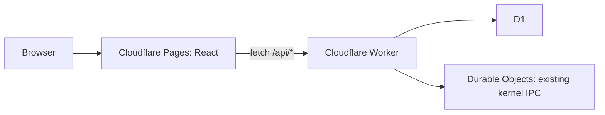

# Pages and Worker boundary

For the additive ICVS automation contracts, scheduler, managed approvals and execution gates, see [ICVS automation](06_ICVS_AUTOMATION.md). The visibility contracts below remain compatible; automation-managed projects additionally consume approved gates and own their workflow stage.

ICVS lives in `icvs/index.ts`; MAX-CORE is the independent platform-neutral foundation workspace. The visibility dashboard itself does not execute products. The additive ICVS automation module now supplies a scheduled workflow runner and evidence-gated publication work; see the automation guide above. Integration observation ingestion is described below. Approval decisions record governor intent; they do not publish products automatically.

## API

All responses are JSON. New endpoints return 404 for unknown routes or IDs, 405 for unsupported methods, and generic 500 errors if storage fails. Legacy `/api/kernel/*` behavior and root status are preserved, including the existing wildcard kernel CORS policy. The existing recovery and ICVS ingestion URLs in the Dart client are still placeholders in the kernel and are not implemented by this change.

| Endpoint                          | Response                                                                     |
| --------------------------------- | ---------------------------------------------------------------------------- |
| `GET /api/dashboard`              | `{ projects, activeProducts, readyToPublish, approvals, health }`            |
| `GET /api/products`               | Array of products                                                            |
| `GET /api/products/:id`           | One product, or 404                                                          |
| `GET /api/portfolio`              | Products ranked by score, highest first                                      |
| `GET /api/pipeline`               | Array of `{ stage, products }` covering all six stages                       |
| `GET /api/approvals`              | Pending `{ id, productId, project, action, priority, risk, status }` records |
| `POST /api/approvals/:id/approve` | `{ success: true, status: "approved" }`                                      |
| `POST /api/approvals/:id/reject`  | `{ success: true, status: "rejected" }`                                      |
| `GET /api/analytics`              | `{ stage, count, averageScore }[]`                                           |
| `GET /api/telemetry`              | `{ state, count }[]` from virtual processes                                  |
| `GET /api/governance`             | `{ status, count }[]` from approval history                                  |

Product fields: `id`, `name`, `description`, `stage`, `score` (0–100), and `updatedAt` (SQLite UTC timestamp). Stages: Idea, Validation, Build, Ready, Live, Archived. Active products means Live; ready to publish means Ready. Process health is the rounded percentage of READY, RUNNING, and SUSPENDED processes among all stored processes. It is `null` when there are none. This measures stored process states, not a live heartbeat or infrastructure SLA.

Decision requests require `Authorization: Bearer <GOVERNOR_API_TOKEN>`. Missing server configuration returns 503; invalid authorization returns 401. Decisions atomically update only pending requests; a second decision returns 409, a nonexistent ID returns 404. Changes persist in D1. SQL values are parameterized. The API does not accept arbitrary product edits.

The new API allows browser origins listed in comma-separated `ALLOWED_ORIGINS`. Configure exact scheme/host/port values. OPTIONS permits Content-Type and Authorization. Disallowed browser origins receive 403. CORS is not authentication; non-browser clients can access public read routes. API responses use `Cache-Control: no-store`.

## Cloudflare deployment

1. Confirm the existing D1 database ID and Durable Object namespace in `wrangler.toml` belong to the intended account. The `v1` actor migration and class name are preserved. Do not recreate them for an existing deployment.
2. Add the exact deployed Pages/custom origins to `ALLOWED_ORIGINS` in `wrangler.toml`. Add individual preview origins when needed; wildcard subdomains are not interpreted.
3. Apply migrations with `npx wrangler d1 migrations apply DB --remote`. Migration 0001 uses the existing kernel schema with `IF NOT EXISTS`; 0002 adds products and approvals. Existing kernel rows remain intact. Do not run the demo seed remotely.
4. Set the Worker secret with `npx wrangler secret put GOVERNOR_API_TOKEN` and deploy with `npm run deploy:worker`.
5. Create a Cloudflare Pages project connected to this monorepo. Set root directory to the repository root, build command `npm ci && npm run build`, output directory `apps/pages/dist`, and Node version 24 (or 22.12+).
6. Set **Pages build variable** `VITE_API_URL=https://portal-os1.maxjurreau.workers.dev` for production and the intended API origin for previews. Rebuild after changing it. No secrets belong in Pages `VITE_` variables.
7. Alternatively run `npm run deploy:pages` after authenticating Wrangler and configuring the build variable in the local build environment. Pages' default SPA fallback handles direct links; no top-level `404.html` is emitted.
8. Populate real product and approval data through trusted backend integrations. Empty production tables display empty states. The optional seed is synthetic local data only.

The pre-existing workflow under `github/workflows/` is not an active GitHub Actions path. This implementation documents explicit deployment commands rather than enabling automatic production deployment. Run type checks, tests and build before deployment. Cloudflare pricing and account quotas must be checked against actual usage; this structure cannot guarantee a zero-dollar bill.

## Governor Console visibility baseline

Apply `0003_console.sql` after the existing migrations. It preserves the existing product stage and approval status constraints and existing GET response shapes. The five requested portfolio divisions are configuration records, not synthetic products. Assign existing products to a division through the trusted catalogue integration using `products.unit_id`. No browser product-specific conditions or MAX-CORE dependencies are introduced. This iteration leaves MAX-CORE untouched.

New and extended contracts:

- `GET /api/console`: a single D1 batch snapshot of products, division configuration, pending approvals, factory stages, department observations, rankings, health coverage, revenue groups, recommendations, forecasts and alerts. This is the dashboard and portfolio read model; existing APIs remain available to existing consumers.
- `GET /api/system-health`: live API/D1/kernel-root Durable Object probes plus stored process-state health. No queue binding exists: queue health is explicitly unknown. Runtime process states do not establish heartbeat liveness.
- `POST /api/session`: verify the existing governor bearer token before enabling the console's decisions. The token remains in memory; this is not a multi-user identity service. Reads remain public under the existing contract. Cloudflare Access is still needed for a private deployment.
- `POST /api/approvals/:id/override`: accepts `{ "reason": "10–1000 character explanation" }`, authenticated with the governor token. Override is an explicit exception that approves a **pending** request. It does not amend a prior decision, execute an action or publish anything. Existing `approved`/`rejected` statuses remain compatible. Every new decision is recorded atomically by a D1 trigger in `governor_decisions`; updates and deletes of that ledger are rejected. Existing decisions are not backfilled with invented audit data.
- `GET /api/decisions`: governor-authenticated latest 100 ledger entries. The shared governor token cannot establish individual human attribution.
- `POST /api/telemetry`: integration-only observations using a separate `OBSERVATION_API_TOKEN` secret. The existing `GET /api/telemetry` contract is unchanged. Configure the secret only for backend producers, never in a `VITE_` variable or browser. Missing configuration returns 503; wrong credentials 401. Bodies over 16 KiB return 413; invalid fields 400; unknown products 404; older/equal observations 409.

### Observation producer contract

Send a complete latest snapshot, not a partial patch. Omitted optional fields clear their prior values. `source` is a non-empty producer identifier (max 200 characters); `observedAt` is a canonical UTC ISO timestamp with milliseconds, no later than the current time. The timestamp is compared atomically during upsert so out-of-order deliveries cannot overwrite newer state. Producers should send only their own current observations.

Product observations contain `kind: "product"`, an existing `productId`, `source`, `observedAt` and optional:

- `workflowStage`: Idea, Discovery, Specification, Architecture, Simulation, Build, Test, Package, Ready or Published.
- `status`: queued, running, blocked or complete.
- `health`: number from 0 to 100.
- `revenueMinor`: non-negative safe integer in the currency's ISO minor units; requires a three-letter uppercase `currency` and non-empty `revenuePeriod`. The UI uses the currency's minor-unit exponent. Different currencies and reporting periods are never combined.
- `forecast`: producer-supplied outlook up to 2,000 characters; `forecastDueAt`: parseable target date. No forecast is fabricated from an arbitrary score.

Department observations contain `kind: "department"`, `department` (GOV, STRAT, ARCH, BUILD, TEST, OPS, DATA, GROWTH), `status`, `source`, `observedAt` and optional `health`, non-negative integer `queue`, `currentWork`, `kpiName`, `kpiValue`.

Observations older than 24 hours are labelled stale and excluded from aggregate health and revenue. Missing values remain null, never synthetic zeroes. Recommendations use explicit Worker rules: fresh blockers, Ready products to review, and Ideas with recorded scores of at least 80. Stale explicit workflow observations do not generate recommendations. Alerts reflect high-risk pending decisions, panicked stored processes and fresh product health below 50. Every displayed forecast carries its source and freshness.

Legacy Idea/Build/Ready/Live map to Idea/Build/Ready/Published only when no explicit workflow observation exists. Validation and Archived remain in an unclassified list; the implementation does not pretend they traversed intermediate stages. Test includes QA; Ready is ready to publish. Factory counts represent current position, not stage-completion history.

### Integration and deployment limits

This iteration provides operational visibility and an observation ingestion contract. It does not add a scheduler, autonomous build/publication executor, financial provider or forecasting model. Existing ICVS producers must be wired to emit these observations; until then departments, revenue and forecasts truthfully show missing data. The Governor's actions remain Approve, Reject and Override.

Run the existing validation commands above. Local browser development now uses Vite's `/api` proxy to port 8787 when `VITE_API_URL` is unset. Production still requires the configured Worker URL and allowed Pages origin. No production migration or deployment is performed by local setup. The Preview starts with empty real local D1 tables; synthetic data is used only in isolated tests.
